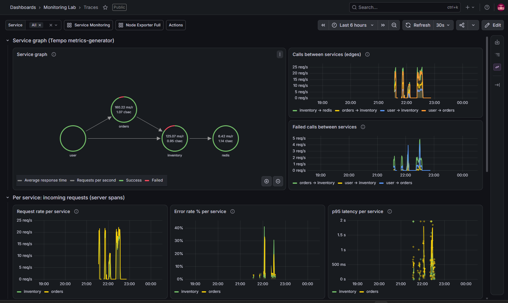
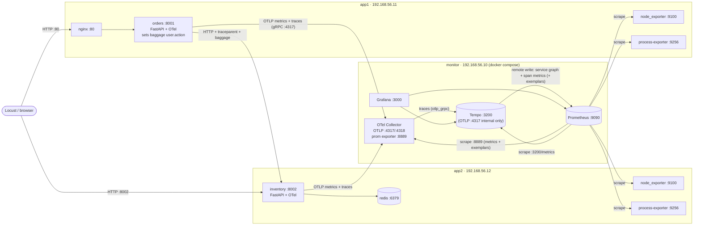

# Monitoring lab (Vagrant + VirtualBox)

A reproducible lab with three Ubuntu 22.04 VMs. Two small FastAPI services generate real
traffic and send OpenTelemetry **metrics and traces** to a monitor VM:

- **Phase 1 (metrics):** Prometheus + Grafana, filterable by **service** and **time range**
  (dashboard *Service Monitoring*).
- **Phase 2 (traces):** Grafana Tempo stores every trace. A service graph and span metrics are
  derived from the traces (dashboard *Traces*), and every request is tagged with the **user
  action** (API route) that started it, so all services involved in one action can be seen
  together (dashboard *Actions*).



## Architecture



Details: [docs/tracing-architecture.md](docs/tracing-architecture.md) covers the full tracing
pipeline, tech stack, headers, timing and failure behaviour, and
[docs/traces-dashboard.md](docs/traces-dashboard.md) explains the Traces dashboard panel by
panel, with screenshots.

How a request flows through tracing: orders receives `POST /orders` and starts a trace. Its
middleware sets `user.action = "POST /orders"` (the route template) as a span attribute and as
OTel baggage. httpx sends `traceparent` and `baggage` headers to inventory, which continues the
same trace. `BaggageSpanProcessor` copies `user.action` onto every span, including the redis
client spans. All spans go to the collector, then to Tempo. Tempo's metrics-generator turns
the spans into `traces_service_graph_*` and `traces_spanmetrics_*` series and writes them into
Prometheus with exemplars (trace IDs).

| VM | IP | Size | Runs |
|----|----|------|------|
| monitor | 192.168.56.10 | 2 CPU / 3072 MB | Docker CE + Compose: OTel Collector `0.162.0`, Prometheus `v3.15.0`, Tempo `3.1.0`, Grafana `13.2.3` |
| app1 | 192.168.56.11 | 1 CPU / 1024 MB | nginx (:80 → orders), `orders.service` (:8001), node_exporter, process-exporter |
| app2 | 192.168.56.12 | 1 CPU / 1024 MB | `inventory.service` (:8002), redis, node_exporter, process-exporter |

You can change the VM sizes and IPs in the `VMS` table at the top of the [Vagrantfile](Vagrantfile).

## Start / stop

Run from **Windows PowerShell** in this folder:

```powershell
vagrant up                 # create + provision all 3 VMs (first run: ~15-30 min on this laptop)
vagrant status
vagrant halt               # stop the VMs (keeps disks, Prometheus/Tempo data and Grafana state)
vagrant up                 # start them again (no re-provisioning)
vagrant provision monitor  # re-apply changes made under monitoring/ (copied to /opt/monitoring)
vagrant provision app1     # re-apply service / exporter changes on app1
vagrant destroy -f         # delete the VMs completely
```

> On this laptop VirtualBox runs on top of Hyper-V, and **booting a VM can take 10–30 minutes**
> (see [Troubleshooting](#troubleshooting)). Prefer `vagrant provision` (no reboot) over
> `vagrant reload` / `halt` + `up` where you can.

## URLs

| What | URL |
|------|-----|
| Grafana (admin / admin) | http://192.168.56.10:3000. The home dashboard is **Service Monitoring**; the others are in the *Monitoring Lab* folder. |
| Service Monitoring | http://192.168.56.10:3000/d/service-monitoring |
| Traces | http://192.168.56.10:3000/d/traces |
| Actions | http://192.168.56.10:3000/d/actions |
| Node Exporter Full | http://192.168.56.10:3000/d/rYdddlPWk |
| Grafana Explore (traces) | http://192.168.56.10:3000/explore → datasource **Tempo** |
| Prometheus | http://192.168.56.10:9090 (targets at http://192.168.56.10:9090/targets) |
| Tempo API | http://192.168.56.10:3200 (`/ready`, `/metrics`, `/api/search?q=<TraceQL>`, `/api/v2/traces/<id>`) |
| OTel Collector metrics | http://192.168.56.10:8889/metrics |
| orders via nginx | http://192.168.56.11/orders · API docs at http://192.168.56.11/docs |
| inventory | http://192.168.56.12:8002/stock · http://192.168.56.12:8002/docs |

Tempo's OTLP port is **not** published on the VM. Only the collector sends spans to it, over
the docker network.

## Sample services

| Service | Endpoints |
|---------|-----------|
| orders | `GET /orders`, `POST /orders {"item_id":"item-3","qty":1}` (calls inventory twice), `GET /orders/{order_id}`, `GET /orders/flaky` (HTTP 500 about 30% of the time), `GET /health` |
| inventory | `GET /stock`, `GET /stock/{item_id}`, `POST /stock/{item_id}/reserve?qty=`, `POST /stock/{item_id}/restock`, `GET/POST /admin/chaos` (inject latency and error rate; 2% errors by default), `GET /health` |

Both services run as systemd units (`orders.service`, `inventory.service`) from a venv in
`/opt/<service>`. They are instrumented by `opentelemetry-instrument`; see the
`Environment=OTEL_*` lines in [services/orders/orders.service](services/orders/orders.service):
`OTEL_TRACES_EXPORTER=otlp`, `OTEL_PROPAGATORS=tracecontext,baggage`, and
`OTEL_PYTHON_FASTAPI_EXCLUDED_URLS=/health` (health checks produce no spans and no HTTP
metrics). The only tracing code in the apps is:

- **orders**: `UserActionMiddleware` (sets `user.action`) and `BaggageSpanProcessor`.
- **inventory**: `BaggageSpanProcessor`.
- **both**: `record_exception` on deliberate errors, so the trace shows the reason.

## Dashboards

### Service Monitoring (phase 1): how the filters work

Every service-level series in Prometheus has a **`service_name`** label with the same value
as `OTEL_SERVICE_NAME`:

| Source | Example metric | How `service_name` is set |
|--------|----------------|---------------------------|
| OpenTelemetry SDK → Collector | `http_server_duration_milliseconds_*` (labels `http_target` = route template, `http_status_code`, `http_method`) | the `service.name` resource attribute becomes a label through `resource_to_telemetry_conversion` in the collector's prometheus exporter |
| process-exporter | `namedprocess_namegroup_*` | `metric_relabel_configs` copies the `groupname` label (process groups `orders`, `inventory`, `nginx`, `redis`) |
| node_exporter systemd collector | `node_systemd_unit_state` | `metric_relabel_configs` derives it from the unit name (`orders.service` → `orders`, `redis-server.service` → `redis`) |

The OTel metric names come from the instrumentation version (`opentelemetry-instrumentation-fastapi`
0.66b1 still emits the *old* HTTP semantic conventions). If you set
`OTEL_SEMCONV_STABILITY_OPT_IN=http` or upgrade to a version that uses the stable ones,
the metric becomes `http_server_request_duration_seconds` with `http_route` and
`http_response_status_code`, and the dashboard queries must be updated to match.

`instance` is also normalised to the host name (`app1`, `app2`) on all three sources, so the
**Host** filter applies everywhere.

Variables:

- **Host**: `label_values(up{job="node"}, instance)`. Multi-select with *All*.
- **Service**: `label_values(namedprocess_namegroup_num_procs{instance=~"$host"}, service_name)`.
  Multi-select with *All*.
- **Time range**: the Grafana time picker (default *Last 1 hour*), with auto-refresh (default 30s).

Layout:

1. **Overview**: services up, total requests/sec, error rate %, resident memory.
2. **Service: $service**: a row repeated per selected service. It shows service running,
   CPU %, memory, threads, requests/sec by route, **latency p50/p95 with exemplars**, and
   error rate %.
3. **Hosts ($host)**: CPU, memory, disk, network.

### Traces (phase 2)

Panel-by-panel explanation: [docs/traces-dashboard.md](docs/traces-dashboard.md).

Built from the traces by Tempo's metrics-generator. Variable **Service** =
`label_values(traces_spanmetrics_calls_total, service)`; same name, so the dashboard links
carry it over.

- **Service graph** (node graph): `user → orders → inventory → redis` with call rates and
  error rates. redis is a *virtual* node, derived from the `db.system` attribute of the redis
  client spans. It is shown next to time series of calls and failed calls per edge.
- **Per service** (server spans): request rate, error rate %, p95 latency.
- **Per operation** (`span_name`, every span kind): the same three. This includes outgoing
  HTTP calls (`GET`, `POST`) and redis commands (`GET`, `EXISTS`, `DECRBY`).
- **Recent traces** (TraceQL tables): slow traces
  (`{ resource.service.name =~ "$service" && traceDuration > 300ms }`) and error traces
  (`{ ... && status = error }`). Click a trace ID to open the trace.

### Actions (phase 2): stats per user action

"Action" means the entry route on orders, as `"<METHOD> <route template>"`, e.g.
`POST /orders` or `GET /orders/{order_id}`. It is the matched route **template**, never the
raw URL, so the label stays low-cardinality. The action is sent along as baggage and copied
onto every span, and Tempo adds it to span metrics as the `user_action` label
(`dimensions: [user.action]` in [tempo.yaml](monitoring/tempo/tempo.yaml)).

No list of actions is maintained anywhere. A new route shows up in the **Action** dropdown
(`label_values(traces_spanmetrics_calls_total, user_action)`) as soon as it is called. The
**Service** dropdown is chained to it
(`label_values(traces_spanmetrics_calls_total{user_action="$action"}, service)`), so it lists
exactly the services involved. For `POST /orders` that is orders and inventory; the `GET` routes
only touch orders.

Panels: calls per service in the time range, calls/sec per service, error rate % per
service, p95 latency per service and per `span_name` (with exemplars), and a TraceQL table
`{ span.user.action = "$action" }` with example traces.

All dashboards link to each other (top right), keeping the time range and `$service`.
Dashboards are generated by [scripts/generate-dashboards.py](scripts/generate-dashboards.py).
Edit that script, run `python scripts/generate-dashboards.py`, then `vagrant provision monitor`.

## Searching traces in Grafana Explore

1. Open **Explore** (compass icon) and pick the **Tempo** datasource.
2. **Search** tab: choose *Service Name*, *Span Name*, *Status* and *Duration*, then *Run query*.
3. **TraceQL** tab examples:

   | Goal | TraceQL |
   |------|---------|
   | all traces of one action | `{ span.user.action = "POST /orders" }` |
   | slow inventory work | `{ resource.service.name = "inventory" && kind = server && duration > 300ms }` |
   | errors with a reason | `{ status = error && resource.service.name = "inventory" }` |
   | orders calling inventory | `{ resource.service.name = "orders" } >> { resource.service.name = "inventory" }` |
   | redis commands slower than 5 ms | `{ span.db.system = "redis" && duration > 5ms }` |
   | traces with a 502 | `{ span.http.status_code = 502 }` |

4. Click a trace to open the waterfall. Red spans have status ERROR; the *Events* section
   holds `exception` events with type and message. *Related metrics* on a span (from
   `tracesToMetrics`) jumps to the span-metrics rate, error and p95 queries for that operation.
5. **Service Graph** tab: the same node graph as on the Traces dashboard.

From PowerShell: `.\scripts\find-trace.ps1 '<TraceQL>'` prints the newest matching trace as
a span tree with durations, errors and exception messages.

## How exemplars work

An exemplar is one sample measurement, here a request duration, stored together with the
**trace ID** of the request that produced it. Grafana draws exemplars as small diamonds on
latency charts. Hover over one to see its value and trace ID, and click it to open that exact
trace in Tempo.

Both sources produce them in this lab (checked with Prometheus `/api/v1/query_exemplars`):

| Chart | Metric | Path | Trace-ID label |
|-------|--------|------|----------------|
| Service Monitoring → *Latency p50/p95* | `http_server_duration_milliseconds_bucket` | Python OTel SDK records an exemplar for sampled requests → OTLP → collector prometheus exporter (`enable_open_metrics: true`) → Prometheus scrape | `trace_id` |
| Traces / Actions → *p95 latency* | `traces_spanmetrics_latency_bucket` | Tempo metrics-generator → remote write (`send_exemplars: true`) | `traceID` |

Prometheus keeps exemplars because it runs with `--enable-feature=exemplar-storage`. The
Prometheus datasource maps **both** label names to Tempo via `exemplarTraceIdDestinations`.

## Production concerns

- **Sampling.** The lab keeps 100% of traces. In production that is usually too expensive.
  The collector config contains a commented `tail_sampling` example: it keeps every error and
  every trace slower than 300 ms, plus 10% of the rest. Tail sampling needs all spans of a
  trace at the same collector instance (use a `loadbalancing` exporter keyed by trace ID with
  several collectors). Span metrics are computed from the spans Tempo *receives*, so with
  sampling, either generate them before sampling (e.g. the collector's `spanmetrics`
  connector) or correct for the sampling rate.
- **Retention and size.** Tempo keeps blocks for **72h** on the VM's disk (`block_retention`
  in [tempo.yaml](monitoring/tempo/tempo.yaml)); Prometheus keeps metrics for 30 days. Real
  deployments put Tempo on object storage (S3/GCS/Azure). Watch the cardinality of span-metric
  dimensions: each `user_action` value multiplies the `traces_spanmetrics_*` series.
- **PII in span attributes.** Spans record full URLs (`http.target` includes path parameters
  and query strings), client IPs, user agents, exception messages and redis command names, and
  header capture can be switched on with env vars. Baggage travels to *every* downstream service, including third
  parties, so never put user IDs, e-mails, tokens or card data in baggage or span attributes.
  This lab copies only the `user.action` baggage key onto spans, and that value is a route
  template. Use the collector's `attributes` / `redaction` / `transform` processors to drop or
  hash sensitive attributes centrally, and restrict who can query Tempo.
- **Exposure.** Grafana uses admin/admin and every port is plain HTTP on a host-only network.
  Fine for a lab, not for anything reachable by others.

**Deploying to real servers:** [deploy/README.md](deploy/README.md) has a production setup
(Docker Compose) that addresses the points above: HTTPS, firewalling, alerting, PII
scrubbing, per-server agents.

## Testing

See [TESTING.md](TESTING.md) for load tests, CPU stress, stopping services,
latency/error injection, and the phase 2 trace tests. Quick check:

```powershell
.\scripts\load-test.ps1 -Users 20 -Duration 2m
.\scripts\verify.ps1          # targets, labels, datasources, every panel of every dashboard
.\scripts\verify-traces.ps1   # Tempo ready, a connected orders->inventory->redis trace, exemplars
```

## Repository layout

```
Vagrantfile                 VM definitions (sizes at the top)
provision/                  shell provisioners (common, exporters, monitor, app1, app2, python-service)
                            (folders are uploaded to /vagrant in each VM by the Vagrantfile)
services/                   orders + inventory FastAPI apps, systemd units, nginx site
exporters/                  node_exporter args, process-exporter groups
monitoring/                 docker compose stack -> /opt/monitoring on the monitor VM
  otel-collector/config.yaml  metrics + traces pipelines, commented tail_sampling example
  prometheus/prometheus.yml
  tempo/tempo.yaml            Tempo 3.1 monolithic, 72h retention, metrics-generator
  grafana/provisioning/       Prometheus + Tempo datasources, dashboard provider
  grafana/dashboards/         service-monitoring, traces, actions (generated), node-exporter-full (grafana.com 1860)
scripts/                    locustfile, load/stress/chaos scripts, verify*.ps1, find-trace.ps1,
                            generate-dashboards.py
```

## Troubleshooting

- **VirtualBox is very slow / boot times out / "VT-x is not available" / `VERR_NEM_*`**:
  Hyper-V is active on this laptop (WSL2 / Virtual Machine Platform), so VirtualBox runs in its
  slow NEM mode (`VBox.log`: "HM: HMR3Init: Attempting fall back to NEM: VT-x is not
  available"; "TM: Giving up catch-up attempt"). Boots took 7–30 minutes, and the Vagrantfile
  sets `BOOT_TIMEOUT = 900`. If `vagrant up`/`reload` reports *Timed out while waiting for the
  machine to boot*, the VM is usually still booting. Wait until `vagrant ssh <vm>` works,
  then run `vagrant provision <vm>`. If the VM never finished its first boot, run
  `vagrant reload <vm> --provision` so that the host-only IP and hostname get applied. To check
  (and optionally change, which is your call) the Hyper-V situation:
  - `systeminfo` → "Hyper-V Requirements". If it says "A hypervisor has been detected",
    Hyper-V is on.
  - *Turn Windows features on or off*: **Hyper-V**, **Virtual Machine Platform**,
    **Windows Hypervisor Platform**, **Windows Subsystem for Linux**.
  - Windows Security → Device security → Core isolation → **Memory integrity**.
  - Admin prompt: `bcdedit /enum {current}` → `hypervisorlaunchtype`.
  - Disabling these (`bcdedit /set hypervisorlaunchtype off` + reboot) makes VirtualBox fast,
    but **breaks WSL2/Docker Desktop** until you turn it back on.
- **No shared folder**: the `ubuntu/jammy64` box has no working `vboxsf`, so the Vagrantfile
  disables `/vagrant` syncing and uploads `provision/ services/ exporters/ monitoring/
  scripts/` over SSH on every `vagrant provision`. After editing files, run
  `vagrant provision <vm>`.
- **`vagrant ssh` says "Permission denied (publickey)"**: Windows OpenSSH ignores private
  keys that other accounts can read. Vagrant's per-VM keys in
  `.vagrant/machines/*/virtualbox/private_key` are owner-only and work. The shared insecure key
  in `%USERPROFILE%\.vagrant.d\insecure_private_keys` is also readable by another local group
  on this machine, which only matters for a VM that never finished its first boot.
- **No traces in Tempo**: `.\scripts\verify-traces.ps1`. Then check
  `sum(rate(tempo_distributor_spans_received_total[5m]))` in Prometheus, and the collector logs
  (`docker compose logs otel-collector`) for `tempo:4317` connection errors. Note that a trace
  becomes searchable a few seconds after its last span.
- **Tempo logs `error calling scheduler ... no jobs found`**: harmless. The backend worker
  polls for compaction jobs and there are none.
- **stress-ng exits with SIGILL**: under Hyper-V, some CPU instructions are advertised but
  not supported. `scripts/stress-cpu.ps1` therefore uses `--cpu-method matrixprod`.
- **Scripts won't run** ("running scripts is disabled"): `Set-ExecutionPolicy -Scope Process Bypass`.
- **Line endings**: [.gitattributes](.gitattributes) forces LF for Linux files; the
  provisioners also strip `\r` when they copy files.
- **A service won't start**: `vagrant ssh app1 -c "journalctl -u orders -n 50 --no-pager"`.
- **Monitor stack**: `vagrant ssh monitor -c "cd /opt/monitoring && docker compose ps && docker compose logs --tail 50"`.
