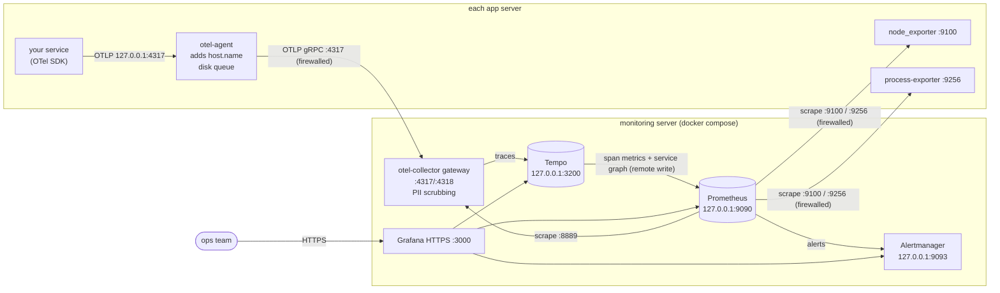

# Production deployment

This folder deploys the lab's monitoring setup (metrics, traces, dashboards) to real servers
with **Docker Compose**. It is independent of the Vagrant lab: nothing here uses Vagrant,
VirtualBox or the sample apps.

| Folder | Runs on | What it is |
|--------|---------|------------|
| [monitoring/](monitoring/) | **one** server: dedicated, or one of the app servers | OTel Collector (gateway), Prometheus, Alertmanager, Tempo, Grafana |
| [agent/](agent/) | **every** server, including the monitoring server | node_exporter, process-exporter, OTel Collector (agent) |
| [app-instrumentation/](app-instrumentation/) | each instrumented service | OpenTelemetry env settings for the app |
| [scripts/](scripts/) | as needed | Docker install, firewall rules |

**Deploying with an AI agent?** [DEPLOYMENT-AGENT.md](DEPLOYMENT-AGENT.md) has a preparation
checklist and a ready-to-fill prompt that walks an agent through these steps with approval
gates, verification and a rollback list.

## Architecture



What changed compared to the lab:

| Area | Lab | Production setup |
|------|-----|------------------|
| Grafana | HTTP, admin/admin | HTTPS (own or self-signed cert), password from `.env`, no anonymous access, no sign-up |
| Exposed ports | everything on every interface | only Grafana and OTLP; Prometheus / Tempo / Alertmanager on 127.0.0.1 |
| Firewall | none | DOCKER-USER rules for published ports, ufw rules for exporters |
| App → collector | app sends straight to the central collector | local agent per server: adds `host.name`, batches, buffers on disk while the gateway is down |
| Host list | hard-coded IPs in prometheus.yml | `targets/*.yml` (file service discovery, no restart needed) |
| Alerting | none | 13 Prometheus rules + Alertmanager (e-mail / Slack / Teams / webhook) |
| PII | full URLs and client IPs stored | query strings and client IPs removed from spans in the gateway |
| Retention | Prometheus 30d, Tempo 72h | Prometheus 30d **or** size cap, Tempo 7 days (object storage optional) |
| Exporters | apt packages | containers (same versions/flags), so all servers are set up the same way |
| Limits | none | memory limit and log rotation on every container |

Dashboards, datasources, label conventions and the Tempo/collector pipelines are the same as
in the lab, so the *Service Monitoring*, *Traces*, *Actions* and *Node Exporter Full*
dashboards work unchanged.

## Requirements

- Linux servers with systemd (Ubuntu 22.04/24.04 or Debian 12 for `install-docker.sh`;
  any distro works if you install Docker yourself), x86_64.
- Docker Engine with the Compose plugin on every server.
- A private network between the servers. Open these ports, nothing else:

  | From | To | Port |
  |------|----|------|
  | app servers | monitoring server | 4317/tcp (OTLP gRPC) |
  | monitoring server | every server | 9100/tcp, 9256/tcp (exporters) |
  | admins' network | monitoring server | 3000/tcp (Grafana HTTPS) |

- Image downloads from Docker Hub, or mirror these into your registry first:
  `otel/opentelemetry-collector-contrib:0.162.0`, `prom/prometheus:v3.15.0`,
  `prom/alertmanager:v0.28.1`, `grafana/tempo:3.1.0`, `grafana/grafana:13.2.3`,
  `prom/node-exporter:v1.9.1`, `ncabatoff/process-exporter:0.8.7`.

### Sizing (monitoring stack)

| Environment | vCPU | RAM | Disk (Prometheus + Tempo) |
|-------------|------|-----|---------------------------|
| up to ~10 servers, a few hundred req/s | 4 | 8 GB | 100 GB SSD |
| up to ~50 servers or > 1000 req/s | 8 | 16 GB | 250–500 GB SSD, consider Tempo on S3/MinIO |

If the stack shares a server with an application, add these numbers on top of what the
application needs. The memory limits in `docker-compose.yml` add up to about 11 GB: they
are upper caps, not reservations.

Rough disk estimates: Prometheus needs ~1–2 bytes per sample, i.e. 50,000 active series at a
15 s interval ≈ 15–25 GB for 30 days. Tempo needs ~(spans/sec × ~1 KB × retention) before
compression. Check real usage after a week (*Node Exporter Full* → disk).

## Step-by-step

The paths below assume the folder is copied to `/opt/observability` on each server
(e.g. `scp -r deploy/ server:/tmp/ && sudo mv /tmp/deploy /opt/observability`).
Make the scripts executable once: `sudo chmod +x /opt/observability/*/deploy.sh /opt/observability/scripts/*.sh`.

### 1. Docker and settings (every server)

```bash
sudo /opt/observability/scripts/install-docker.sh
cd /opt/observability
sudo cp .env.example .env && sudo chmod 600 .env && sudo nano .env
```

All settings live in this one file, [.env.example](.env.example). It has three sections:

| Section | Edit on |
|---------|---------|
| SHARED (monitoring server IP, environment name) | identical on every server |
| PER-SERVER (`HOST_NAME`, `EXPORTER_BIND_IP`, `SYSTEMD_UNITS`) | each server, for that server |
| MONITORING SERVER ONLY (Grafana, retention, firewall sources) | the monitoring server; app servers can leave it as is |

Easiest: fill in the shared and monitoring sections once, copy the file to every server, and
change only the per-server section there. The deploy scripts link `monitoring/.env` and
`agent/.env` to this file, so plain `docker compose` commands in those folders use it too.

### 2. Monitoring server

```bash
cd /opt/observability/monitoring
sudo cp prometheus/targets/node.yml.example prometheus/targets/node.yml
sudo cp prometheus/targets/process.yml.example prometheus/targets/process.yml
sudo nano prometheus/targets/node.yml prometheus/targets/process.yml   # one entry per server
sudo nano alertmanager/alertmanager.yml             # where alerts are sent (e-mail, Slack, Teams, webhook)
sudo ./deploy.sh
```

`deploy.sh` checks `deploy/.env`, creates a self-signed certificate if `certs/grafana.crt` is
missing, validates every config (compose, promtool, amtool, collector), starts the stack and
waits until Grafana, Prometheus, Tempo and Alertmanager are ready. To use a real certificate,
put `grafana.crt` (full chain) and `grafana.key` into `certs/` before running it.

Then lock down the published ports and make the rules survive reboots:

```bash
sudo /opt/observability/scripts/firewall-monitoring.sh --install
```

### 3. Agent (every server, including the monitoring server)

```bash
cd /opt/observability/agent
sudo nano process-exporter/config.yml            # your service processes
sudo ./deploy.sh
sudo /opt/observability/scripts/firewall-agent.sh
```

The agent uses the SHARED and PER-SERVER sections of `deploy/.env`.

`HOST_NAME` must be the same as the `instance` label for this server in the monitoring
server's `targets/*.yml`. `deploy.sh` prints which process groups it found, so a wrong
pattern in `process-exporter/config.yml` shows up immediately.

`firewall-agent.sh` only adds ufw rules for 9100/9256. It never enables ufw or changes the
default policy, so it cannot lock you out.

### 4. Instrument the applications

For each service, install [otel.env.example](app-instrumentation/otel.env.example) as
`/etc/otel/<service>.env`, set `OTEL_SERVICE_NAME`, and add it to the systemd unit:

```ini
[Service]
EnvironmentFile=/etc/otel/orders.env
ExecStart=/opt/orders/venv/bin/opentelemetry-instrument /opt/orders/venv/bin/uvicorn main:app --host 0.0.0.0 --port 8001
```

Then `sudo systemctl daemon-reload && sudo systemctl restart orders`.

**Naming rule:** use the same name in three places, or the dashboards' *Service* filter
won't join the data: `OTEL_SERVICE_NAME` = process-exporter group name = systemd unit name
(without `.service`). If a unit name differs (like `redis-server` → `redis`), add a mapping
in `monitoring/prometheus/prometheus.yml` (there is an example).

Language notes:

| Language | How to instrument | Dashboard note |
|----------|-------------------|----------------|
| Python (as in the lab) | `pip install opentelemetry-distro opentelemetry-exporter-otlp && opentelemetry-bootstrap -a install`, start with `opentelemetry-instrument` | works as is |
| Java | `-javaagent:/opt/otel/opentelemetry-javaagent.jar` | see below |
| Node.js | `npm i @opentelemetry/auto-instrumentations-node`, `node --require @opentelemetry/auto-instrumentations-node/register app.js` | see below |
| .NET | OpenTelemetry .NET automatic instrumentation | see below |

The *Service Monitoring* HTTP panels and the `HighErrorRate` / `HighLatencyP95` alerts query
`http_server_duration_milliseconds_*` with `http_target` / `http_status_code`. That is what
the Python instrumentation emits (old HTTP semantic conventions). Java, Node.js and .NET agents
emit the stable conventions: `http_server_request_duration_seconds_*` with `http_route` /
`http_response_status_code`. For those services, add the stable-name queries to the panels
and alerts (or `OTEL_SEMCONV_STABILITY_OPT_IN=http` on Python to move everything to the
stable names). Host, process, systemd, trace, service graph and span-metric panels work for
every language.

The **Actions** dashboard needs the entry service to put the route template into baggage
as `user.action` and every service to copy it onto its spans, as the lab's
`UserActionMiddleware` and `BaggageSpanProcessor` in
[services/orders/main.py](../services/orders/main.py) do. Without that code, the other
dashboards still work.

### 5. Verify

On the monitoring server:

```bash
# all targets up?
curl -s localhost:9090/api/v1/targets | jq -r '.data.activeTargets[] | "\(.health) \(.labels.job) \(.labels.instance) \(.lastError)"'
# service_name present on all three sources?
for m in http_server_duration_milliseconds_count namedprocess_namegroup_num_procs node_systemd_unit_state; do
  curl -s --data-urlencode "query=count by (service_name, instance) ($m)" localhost:9090/api/v1/query | jq -c '.data.result[].metric'
done
# alert rules loaded, none broken?
curl -s localhost:9090/api/v1/rules | jq -r '.data.groups[].rules[] | "\(.health) \(.name)"'
```

Then open Grafana (`GRAFANA_ROOT_URL`) → *Monitoring* folder → **Service Monitoring**,
**Traces**, **Actions**. Generate some traffic to an app first. To test alerting, stop a
service for 3 minutes: `ProcessNotRunning` and `ServiceNotActive` should arrive at your
Alertmanager receiver.

Prometheus, Alertmanager and Tempo UIs are only on 127.0.0.1. Reach them with an SSH tunnel:
`ssh -L 9090:127.0.0.1:9090 -L 9093:127.0.0.1:9093 user@monitoring-server`, then open
http://localhost:9090.

## Operations

| Task | How |
|------|-----|
| Add a server | Deploy the agent there, add it to `targets/node.yml` and `targets/process.yml` (picked up within a minute, no restart), add its IP to `OTLP_ALLOWED_SOURCES` and re-run `firewall-monitoring.sh` |
| Add a service | Instrument it (step 4), add it to `process-exporter/config.yml` and `SYSTEMD_UNITS` on its server, re-run the agent's `deploy.sh` |
| Change config / alert rules / dashboards | Edit the files, re-run `sudo ./deploy.sh` (validates first, then reloads) |
| Upgrade a component | Change the image tag in `docker-compose.yml` (read its release notes first; Tempo and the collector change config formats between versions), test in staging, re-run `deploy.sh` |
| Grafana admin password | `GRAFANA_ADMIN_PASSWORD` in `deploy/.env` only applies on the very first start. Later: change it in the Grafana UI, or `docker compose exec grafana grafana cli admin reset-admin-password '<new>'` |
| Users | Add them in Grafana (*Administration → Users*) as Viewer / Editor, or configure LDAP / OAuth via `GF_AUTH_*` variables |
| Backup | The configuration is in this folder (keep it in git, without `.env` and `certs/`). Data lives in the Docker volumes `observability_grafana-data` (users, annotations: back this up), `observability_prometheus-data`, `observability_tempo-data`, `observability_alertmanager-data` (silences) |
| Trace volume too high | Enable `tail_sampling` in `monitoring/otel-collector/config.yaml` (comments explain the trade-off) or move Tempo to object storage |
| Logs | `docker compose logs -f <service>` in `monitoring/` or `agent/`. Container logs rotate at 5 × 10 MB |

## Security checklist

- [ ] Strong `GRAFANA_ADMIN_PASSWORD`; personal accounts for people instead of sharing admin
- [ ] Real TLS certificate for Grafana (or the self-signed one distributed to users)
- [ ] `firewall-monitoring.sh --install` run, `OTLP_ALLOWED_SOURCES` contains only app servers
- [ ] `firewall-agent.sh` run on every server, ufw active
- [ ] `deploy/.env` and `monitoring/certs/` readable by root only (`chmod 600 .env`), never committed to git
- [ ] Review span attributes of your apps for personal data; extend `transform/scrub` in the gateway config
- [ ] Never put user IDs, e-mails or tokens into baggage (it is forwarded to every downstream call)
- [ ] OTLP between servers crosses an untrusted network? Enable TLS on the gateway receiver and set `GATEWAY_TLS_INSECURE=false` (comments in both collector configs)

## Troubleshooting

| Symptom | Check |
|---------|-------|
| `TargetDown` for node/process | Agent running on that server (`docker compose ps` in `agent/`)? `curl http://<server>:9100/metrics` from the monitoring server? ufw rule present? |
| No HTTP / trace data for a service | `systemctl show <svc> -p Environment` contains the OTEL vars? Agent healthy (`curl 127.0.0.1:13133`)? Agent logs: `docker compose logs otel-agent` |
| Data from a server stops, agent logs `connection refused` / timeouts | `OTLP_ALLOWED_SOURCES` on the monitoring server includes that server, `firewall-monitoring.sh` re-run? The agent keeps data on disk and sends it once the gateway is reachable again |
| A service row in the dashboard shows only some panels | Names differ between `OTEL_SERVICE_NAME`, process group and systemd unit (see the naming rule) |
| `ServiceNotActive` for a unit that doesn't exist | Remove it from `SYSTEMD_UNITS` |
| Grafana unreachable | `docker compose logs grafana`; certificate files readable by uid 472 (`deploy.sh` sets this); `GRAFANA_ALLOWED_SOURCES` |
| Collector alerts (`CollectorDroppingData` / `CollectorRefusingData`) | Tempo or Prometheus down / full disk, or the gateway hit its memory limit: raise its limit in `docker-compose.yml` or enable sampling |

## How this was tested

The whole setup was deployed on the lab's monitor VM in place of the lab stack, with the
lab's app VMs sending real traffic to it. The following was checked:

- all 11 scrape targets up, all 13 alert rules healthy
- `service_name` / `instance` labels on all three metric sources
- traces searchable, span metrics and service graph generated
- a test span through the agent arrived with `host.name` set, its query string and client IP removed
- the gateway and agent running side by side on one server (shared-server setup)
- Grafana on HTTPS with all four dashboards; anonymous access refused
- stopping a service fired `ProcessNotRunning` and `ServiceNotActive` in Alertmanager
- the firewall: allowed app servers delivered data, OTLP from another host was blocked,
  and Prometheus / Tempo were unreachable from outside

Two bugs found during that test are fixed in these files: the agent's disk queue was not
writable (named volume owned by root), and the collector alert rules used metric names
with a `_total` suffix that collector 0.162 does not have. Not tested: e-mail / Slack
delivery (no receiver configured) and the self-signed certificate replaced by a real one.
