# The "Traces" dashboard, explained

Grafana → **Traces** (http://192.168.56.10:3000/d/traces) · file:
[monitoring/grafana/dashboards/traces.json](../monitoring/grafana/dashboards/traces.json)
(generated by [scripts/generate-dashboards.py](../scripts/generate-dashboards.py), function `traces()`)

This document explains what each panel shows, where its data comes from, the exact query
behind it, and how to read it. All example values are real ones from this lab.

### About the screenshots

All screenshots are real renders of this dashboard (Grafana image renderer, light theme)
covering **2026-10-26 22:19–22:35** (local time, UTC+5:30), with Service = *All*. During that
window a scripted test session ran, so each chart shows normal traffic and two incidents:

| Time | What happened | Command |
|------|---------------|---------|
| 22:19–22:21:30 | no traffic | |
| 22:21:30 | load test starts: 20 Locust users, about 26 req/s, all routes | `.\scripts\load-test.ps1 -Users 20 -Duration 12m` |
| **22:25:25–22:27:25** | **+400 ms latency** injected into every inventory request | `.\scripts\inject-latency.ps1 -Ms 400` |
| **22:28:25–22:29:55** | **30% errors** injected into inventory | `.\scripts\inject-latency.ps1 -Ms 0 -ErrorRate 0.3` |
| 22:33:30 | load test ends | |

Rate and percentile charts average over about a minute, so each incident appears in the
charts about 30–60 s after it starts and fades out about a minute after it ends. There is
also a short latency spike around **22:24** that was *not* caused by the test. Most likely
the VMs were competing for host CPU while a large container image was downloading on the
monitor VM (this laptop runs VirtualBox on top of Hyper-V, so VMs slow down under host load).

---

## 1. Background: traces, spans and the metrics made from them

### Trace and span

A **trace** is the full story of one request as it travels through the system. It consists
of **spans**. A span is one timed operation in one service. For example, one `POST /orders`
produces this trace (taken from the lab):

```
orders     POST /orders                    330 ms   <- SERVER span: orders received the request
  orders     GET                           177 ms   <- CLIENT span: orders calls inventory (httpx)
    inventory  GET /stock/{item_id}        141 ms   <- SERVER span: inventory handles it
      inventory  GET   [db.system=redis]     7 ms   <- CLIENT span: inventory calls redis
  orders     POST                           70 ms   <- CLIENT span: second call to inventory
    inventory  POST /stock/{item_id}/reserve 28 ms
      inventory  EXISTS [db.system=redis]    3 ms
      inventory  DECRBY [db.system=redis]    3 ms
```

Every span records:

| Field | Meaning | Values in this lab |
|-------|---------|--------------------|
| service | which service produced the span (`service.name`) | `orders`, `inventory` |
| span name | what was done | `POST /orders`, `GET /stock/{item_id}`, `GET`, `EXISTS`, ... |
| span kind | the role of the span | **SERVER** = handled an incoming request · **CLIENT** = made an outgoing call (HTTP to another service, or a redis command) · **INTERNAL** = work inside the process (here the ASGI `http send` / `http receive` steps) |
| duration | start to end time | milliseconds |
| status | outcome | **ERROR** or **UNSET** (= no error reported; this lab never sets OK) |
| attributes | extra key/values | `http.status_code`, `db.system=redis`, `user.action`, ... |

### When is a span an ERROR?

The OpenTelemetry instrumentation decides this. The difference between server and client
spans matters when you read the error panels:

| Span kind | Marked ERROR when | Example in this lab |
|-----------|-------------------|---------------------|
| SERVER | the service answered **5xx**, or an unhandled exception occurred. A 4xx answer is the *client's* fault, so the server span stays UNSET. | `GET /orders/flaky` returning 500; `POST /orders` returning 502 when inventory fails. `GET /orders/{order_id}` → 404 is **not** an error. |
| CLIENT (httpx) | the called service answered **4xx or 5xx**, or the connection failed | orders' `GET` call gets 404 for an unknown item → ERROR. Inventory stopped → `ConnectError` → ERROR. |
| CLIENT (redis) | the redis command raised an exception | redis stopped |

Real numbers from the last 30 minutes for orders: client span `GET` had 802 ERROR out of
2,223. Most of these are the 404s from Locust's "unknown item" task, plus the failures from
the stop-inventory test. Server span `GET /orders/{order_id}` had **0** errors although many
of its requests returned 404.

### Where the dashboard data comes from

```
orders / inventory ──OTLP spans──▶ OTel Collector ──▶ Tempo ──┬─▶ stores the traces (72 h)  ──▶ TraceQL table panels
                                                               │                                 + node graph (via Grafana)
                                                               └─▶ metrics-generator ──remote write──▶ Prometheus ──▶ time-series panels
```

The dashboard uses two kinds of data:

1. **Metrics generated from spans** (all time-series panels). Tempo's *metrics-generator*
   looks at every span it receives and keeps counters and histograms. They are written into
   Prometheus every few seconds:

   | Metric family | Made by | What it counts | Labels |
   |---------------|---------|----------------|--------|
   | `traces_spanmetrics_calls_total` | span-metrics processor | number of spans (counter) | `service`, `span_name`, `span_kind`, `status_code`, `user_action` |
   | `traces_spanmetrics_latency_bucket/_sum/_count` | span-metrics processor | span durations (histogram, seconds) | same + `le` |
   | `traces_service_graph_request_total` | service-graph processor | calls from one service to another (counter) | `client`, `server`, `connection_type` |
   | `traces_service_graph_request_failed_total` | service-graph processor | failed calls between them | `client`, `server` |
   | `traces_service_graph_request_server_seconds_*` / `_client_seconds_*` | service-graph processor | call duration seen by server / client (histogram) | `client`, `server`, `le` |

   A real series looks like this:

   ```
   traces_spanmetrics_calls_total{service="inventory", span_name="GET /stock/{item_id}",
       span_kind="SPAN_KIND_SERVER", status_code="STATUS_CODE_UNSET", user_action="POST /orders"}
   ```

   Latency histogram buckets (`le`, seconds): 0.002, 0.004, 0.008, 0.016, 0.032, 0.064,
   0.128, 0.256, 0.512, 1.024, 2.048, 4.096, 8.192, 16.384, +Inf.

2. **The traces themselves** (the two table panels). These are TraceQL searches run directly
   against Tempo.

> These span metrics are **separate** from the phase-1 metric
> `http_server_duration_milliseconds` used on *Service Monitoring*. Both measure the same
> requests: one comes from the SDK in each service, the other is computed by Tempo from the
> spans. Their numbers are close but not identical (different buckets and time windows).

### Operation names you will see (`span_name`)

| service | SERVER spans (incoming requests) | CLIENT spans (outgoing calls) | INTERNAL spans |
|---------|----------------------------------|-------------------------------|----------------|
| orders | `GET /orders`, `POST /orders`, `GET /orders/{order_id}`, `GET /orders/flaky` | `GET`, `POST` (httpx calls to inventory) | `<route> http send`, `<route> http receive` |
| inventory | `GET /stock`, `GET /stock/{item_id}`, `POST /stock/{item_id}/reserve`, `POST /admin/chaos` | redis commands: `GET`, `SET`, `MGET`, `EXISTS`, `DECRBY`, `SETNX`, `PING` | `<route> http send` |

Names are route **templates** (`{item_id}`), not real URLs, so there is one series per
route, not one per item.

---

## 2. The controls at the top

| Control | What it does |
|---------|--------------|
| **Service** | Multi-select, default *All*. Values come from `label_values(traces_spanmetrics_calls_total, service)`, i.e. every service that has sent spans (`inventory`, `orders`). It filters the time-series panels in rows 2–3 and the two trace tables. The service graph (row 1) is **not** filtered. The variable has the same name as on *Service Monitoring*, so the dashboard links carry your selection over. |
| **Time picker** | Default *Last 1 hour*. Every panel uses it. Rates and percentiles are computed over `$__rate_interval` (about 1 minute here), so the charts react about a minute after a change. |
| **Refresh** | Default 30 s. |
| **Links** (top right) | *Service Monitoring*, *Node Exporter Full*, *Actions*. They keep the time range and `$service`. |

## 3. Layout

```
┌──────────────── Row 1: Service graph (Tempo metrics-generator) ────────────────┐
│  [1] Service graph (node graph)            │ [2] Calls between services (edges) │
│                                            ├────────────────────────────────────┤
│                                            │ [3] Failed calls between services  │
├──────── Row 2: Per service: incoming requests (server spans) ──────────────────┤
│ [4] Request rate per service │ [5] Error rate % per service │ [6] p95 latency   │
├──────── Row 3: Per operation (span_name, all span kinds) ──────────────────────┤
│ [7] Request rate per span_name│ [8] Error rate % per span_name│ [9] p95 latency │
├──────── Row 4: Recent traces for $service (TraceQL) ───────────────────────────┤
│ [10] Slow traces (> 300 ms)             │ [11] Error traces                     │
└────────────────────────────────────────────────────────────────────────────────┘
```

The whole dashboard during the test session:

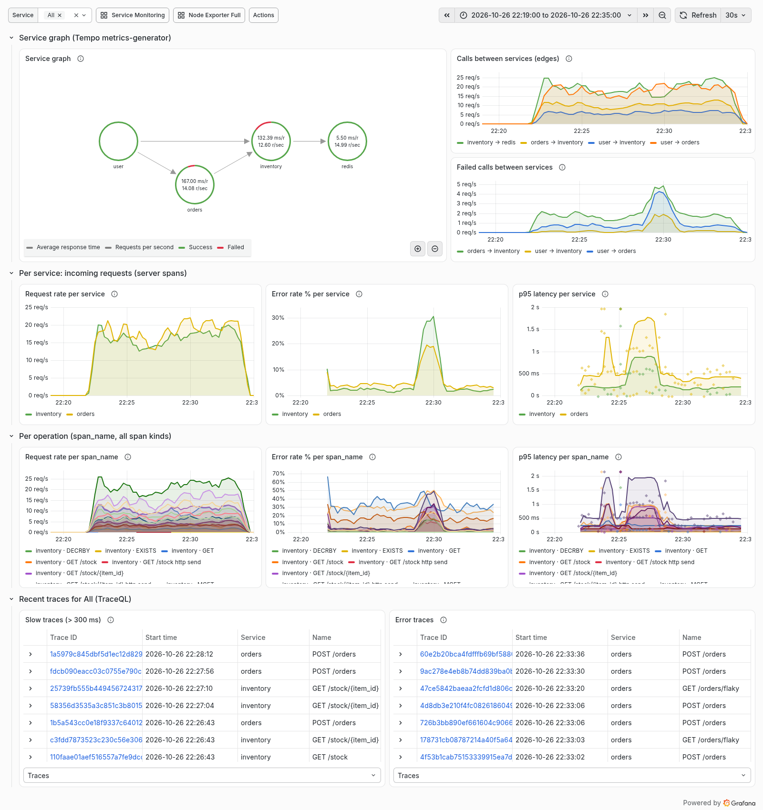

---

## 4. Row 1: Service graph

### [1] Service graph (node graph)

**What it shows:** a map of who calls whom, drawn as circles (services) and arrows (calls).
In this lab:

```
user ──▶ orders ──▶ inventory ──▶ redis
  └──────────────────▲
```

- **user** is not a real service. It stands for "callers outside the traced system" (Locust).
  An arrow from *user* means a request arrived without a parent span.
- **orders → inventory** comes from orders' httpx CLIENT span matched with inventory's SERVER
  span in the same trace.
- **inventory → redis**: redis sends no spans of its own. Tempo creates a *virtual node* from
  the redis CLIENT spans because they carry `db.system=redis` (`peer_attributes` in
  [tempo.yaml](../monitoring/tempo/tempo.yaml)). Its series has `connection_type="database"`.
- **user → inventory** exists because the load test also calls inventory directly.

**Data:** `traces_service_graph_request_total`, `..._failed_total` and the
`..._server_seconds` histogram in Prometheus. The panel's query is the Tempo datasource's
*Service Map* query (`queryType: serviceMap`). Grafana runs the Prometheus queries itself,
using the datasource setting `serviceMap → Prometheus`.

**How to read it:**
- Each circle shows the service's request rate and average response time; hover for details.
- The ring around a circle is coloured by its share of successful (green) vs failed (red)
  calls.
- Click a circle or arrow to get links to the request rate / error / latency of that edge, or
  to the traces of that service.

**What changes in the tests:** stop inventory → the *orders → inventory* edge and the
inventory node turn red, and after a while the *inventory → redis* traffic stops. Stop redis
→ the *inventory → redis* edge turns red.

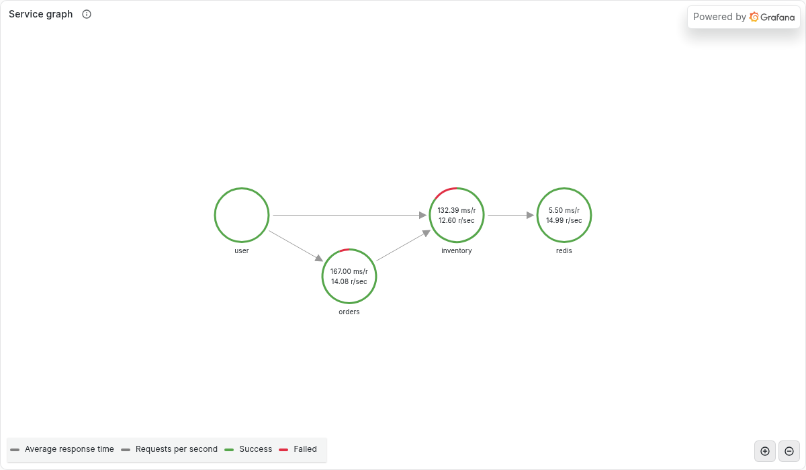

**In the screenshot:** the four nodes and the arrows between them. The numbers are averages
over the whole 16-minute window (including the idle start): orders **167 ms per request,
14.1 req/s**; inventory **132 ms, 12.6 req/s**; redis **5.5 ms, 15.0 req/s**. The red arcs on
orders and inventory are their share of failed calls; most of inventory's red comes from the
30% error phase. *user* shows no numbers because it is not a real service. The legend at the
bottom explains the two numbers and the ring colours.

### [2] Calls between services (edges)

**What it shows:** calls per second on every arrow of the graph, as a time series. One line
per edge, e.g. `orders → inventory`, `inventory → redis`, `user → orders`.

**Query:**
```promql
sum by (client, server) (rate(traces_service_graph_request_total[$__rate_interval]))
```
`rate(...)` turns the ever-growing counter into "per second"; `sum by (client, server)` gives
one line per edge.

**How to read it:** with the default load (20 users) you see roughly:
- `user → orders` about 15–20/s
- `orders → inventory` about 2× the `POST /orders` rate (each order makes two calls)
- `inventory → redis` higher still (several redis commands per request)

When an edge suddenly drops to 0, the caller has stopped calling, or the callee is down so
no matching server span exists.

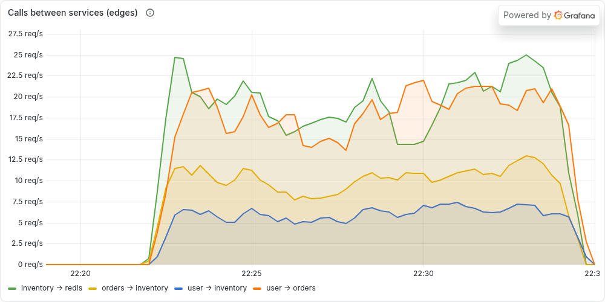

**In the screenshot:** traffic starts at about 22:22. `user → orders` (orange) and
`inventory → redis` (green) run at about 15–25 req/s, `orders → inventory` (yellow) at about
10 req/s, and `user → inventory` (blue) at about 5–7 req/s. **All lines dip at 22:25:30–22:27:30**
(the latency phase): every inventory call took 400 ms longer, so Locust's users finished
fewer requests per second. The lines return to normal afterwards and drop to 0 when the load
test ends at about 22:33:30.

### [3] Failed calls between services

**What it shows:** failed calls per second per edge. A call counts as failed when the client
or the server span of that call has status ERROR.

**Query:**
```promql
sum by (client, server) (rate(traces_service_graph_request_failed_total[$__rate_interval]))
```

**How to read it:** normally small and spiky. `orders → inventory` carries the 404s (unknown
item) and the default 2% injected errors, and `user → orders` carries the flaky endpoint.
It jumps during `inject-latency.ps1 -ErrorRate 0.5` (`orders → inventory`) and when inventory
is stopped. An empty panel ("No data") just means nothing failed in the time range.

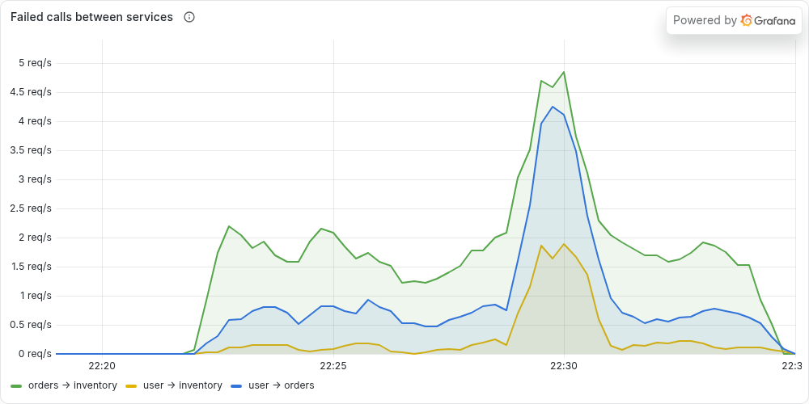

**In the screenshot:**
- **Baseline:** `orders → inventory` (green) fails at about 1.5–2 req/s even in normal operation.
  These are mostly the 404s for unknown items, which the client span counts as failures
  (section 1), plus the default 2% injected errors. `user → orders` (blue) is about 0.5–0.8
  req/s, mainly `/orders/flaky`.
- **The error phase (peak about 22:30):** `orders → inventory` rises to about 4.8 req/s,
  `user → orders` to about 4.2 req/s (orders answers 502 when inventory fails), and
  `user → inventory` (yellow) to about 1.9 req/s (the direct calls hitting the injected errors).
- The latency phase causes **no** extra failures. Slow is not the same as failed.

---

## 5. Row 2: Per service, incoming requests (server spans)

All three panels use only **SERVER** spans (`span_kind="SPAN_KIND_SERVER"`), i.e. requests a
service *received*. This is the classic "RED" view (Rate, Errors, Duration) per service.
Filter: `service=~"$service"`.

### [4] Request rate per service

**What it shows:** requests per second each service handled. One line per service.

**Query:**
```promql
sum by (service) (rate(traces_spanmetrics_calls_total{service=~"$service", span_kind="SPAN_KIND_SERVER"}[$__rate_interval]))
```

**How to read it:** orders ≈ the Locust request rate that goes through nginx. inventory =
direct Locust calls + 2 per `POST /orders`. It should match *Service Monitoring →
Requests/sec* closely (same requests, measured differently).

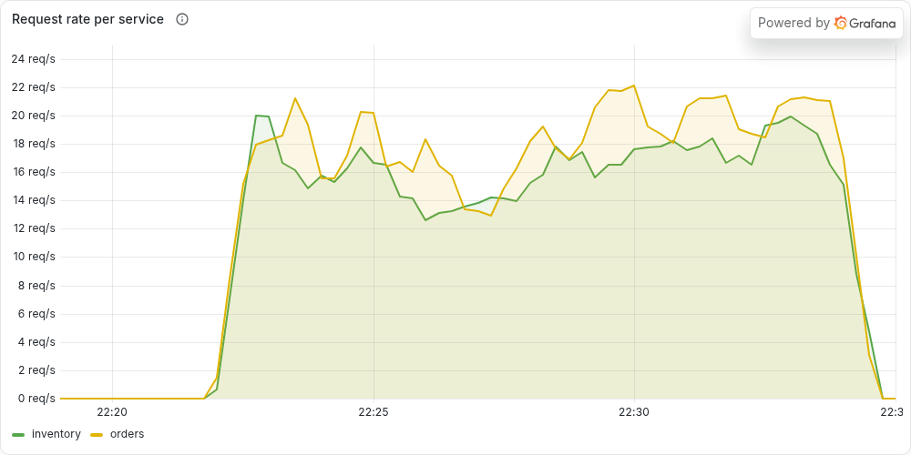

**In the screenshot:** both services handle about 13–22 req/s. They are close because
inventory gets about 6 req/s directly plus two calls per order. The dip at 22:25:30–22:27:30
is the latency phase (slower responses mean fewer requests from a fixed number of users).

### [5] Error rate % per service

**What it shows:** the percentage of received requests that ended with status ERROR (5xx or
an exception).

**Query:**
```promql
100 * (
    sum by (service) (rate(traces_spanmetrics_calls_total{service=~"$service", span_kind="SPAN_KIND_SERVER", status_code="STATUS_CODE_ERROR"}[$__rate_interval]))
  or
    (0 * sum by (service) (rate(traces_spanmetrics_calls_total{service=~"$service", span_kind="SPAN_KIND_SERVER"}[$__rate_interval])))
)
/ sum by (service) (rate(traces_spanmetrics_calls_total{service=~"$service", span_kind="SPAN_KIND_SERVER"}[$__rate_interval]))
```
- Numerator: error spans per second. Denominator: all spans per second.
- The `or (0 * ...)` part makes a service with **no** errors show **0%** instead of
  disappearing from the chart. Without it there would be no error series to divide.

**How to read it:** baseline is a few percent. orders comes from `/orders/flaky` (30% of
that route) and 502s; inventory comes from the default 2% injected errors. 4xx answers
(404, 409) are **not** included (see section 1).

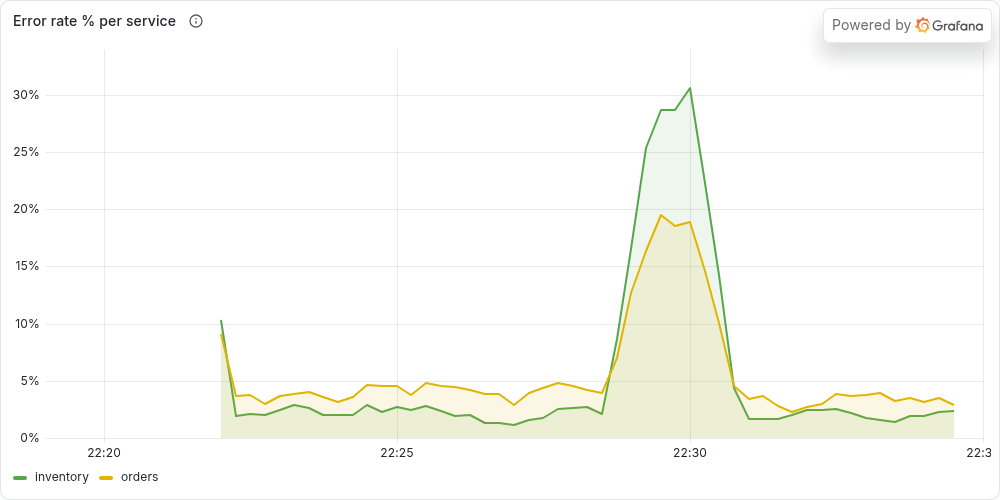

**In the screenshot:**
- **Baseline:** inventory (green) about 2% (the default injected error rate) and orders
  (yellow) about 3–5% (`/orders/flaky` is 30% of a small share of traffic).
- **Error phase:** inventory peaks at about **30%** (exactly the injected rate) and orders at
  about **19%**. orders is lower because only its `POST /orders` route calls inventory; its
  other routes keep succeeding.
- The roughly 10% point at the very start (22:22) is a startup artifact: the first rate
  window contains only a handful of requests.

### [6] p95 latency per service

**What it shows:** the 95th percentile response time of each service: 95% of requests were
faster than this, 5% slower.

**Query:**
```promql
histogram_quantile(0.95,
  sum by (le, service) (rate(traces_spanmetrics_latency_bucket{service=~"$service", span_kind="SPAN_KIND_SERVER"}[$__rate_interval])))
```
The histogram counts how many spans fell into each duration bucket (`le` = "less than or
equal"). `histogram_quantile` estimates the 95% point from those buckets. Unit: seconds
(Grafana shows ms).

**How to read it:**
- Normally orders ≈ 300–500 ms (its `POST /orders` waits for two inventory calls) and inventory ≈ 120–160 ms.
- With `inject-latency.ps1 -Ms 500`, inventory goes up by about 0.5 s and orders by about 1 s
  (two calls).
- **Exemplars** are on (diamonds on the chart). Each one is a real span with its trace ID;
  click it → *Query with Tempo* to open that exact trace.
- The estimate is only as precise as the buckets: between 0.256 and 0.512 s, for example,
  the value is interpolated.

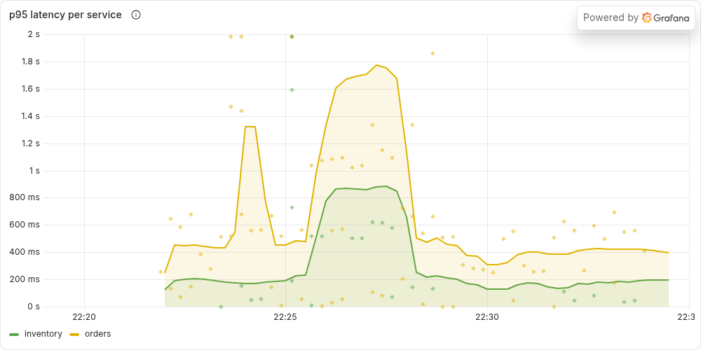

**In the screenshot:**
- **Baseline:** inventory (green) about 150–200 ms and orders (yellow) about 400–450 ms.
- **Latency phase 22:25:30–22:28:** inventory jumps to about **870 ms** and orders to about
  **1.75 s**. orders rises about twice as much because each `POST /orders` waits for two
  inventory calls, each 400 ms slower.
- The **dots are exemplars**: single real requests with their trace ID. During the
  latency phase they cluster around 1–1.3 s for orders. Clicking one opens a trace like the
  one in section 7.
- The narrow orders spike at about 22:24 (about 1.3 s) is the unrelated host-load spike
  mentioned at the top.

---

## 6. Row 3: Per operation (span_name, all span kinds)

Same three measures as row 2, but split by **operation** (`service` + `span_name`) and
including **every** span kind (SERVER, CLIENT, INTERNAL). The legend is
`{{service}} · {{span_name}}`, e.g. `inventory · DECRBY` or `orders · POST /orders`. This is
the row for finding *which step* is slow or failing.

### [7] Request rate per span_name

**Query:**
```promql
sum by (service, span_name) (rate(traces_spanmetrics_calls_total{service=~"$service"}[$__rate_interval]))
```

**How to read it:**
- `orders · GET /orders` is usually the busiest route (highest weight in the locustfile).
- `orders · GET` and `orders · POST` are the outgoing httpx calls to inventory.
- `inventory · GET`, `EXISTS`, `DECRBY`, `MGET` are redis commands. Their rates tell you how
  hard inventory works redis per request.
- `... http send` / `http receive` are internal ASGI steps (one or two per request). They are
  mostly noise; hide them by clicking other series in the legend.

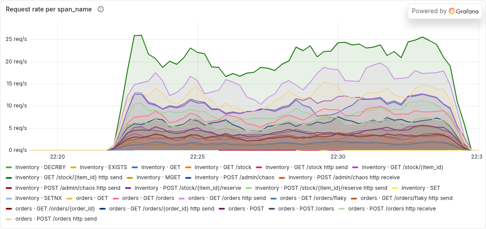

**In the screenshot:** about 30 lines, one per operation. The highest (dark green, about
20–25/s) is `inventory · GET /stock/{item_id} http send`: two internal send steps for every
`GET /stock/{item_id}`. The light purple line at about 15–19/s is `orders · GET /orders http
send`. Below them come the routes and redis commands. `inventory · POST /admin/chaos` appears
as a tiny line because the test script called the chaos endpoint four times. Tip: in
Grafana, click a legend entry to show only that series, or Ctrl/Cmd-click to add more.

### [8] Error rate % per span_name

**Query:** the same formula as panel [5], with `by (service, span_name)` and no `span_kind`
filter.

**How to read it:** this shows *where* errors come from:
- `orders · GET /orders/flaky` ≈ 30%: intentional.
- `orders · GET` (CLIENT call to inventory) is high, about 30–40%. It includes every 404 for
  an unknown item, because client spans count 4xx as errors (section 1). This is expected
  here, not a bug.
- `inventory · GET /stock/{item_id}` and `POST /stock/{item_id}/reserve` ≈ 2% (injected),
  higher during `-ErrorRate` tests.
- `orders · POST /orders` rises when inventory fails (orders returns 502).

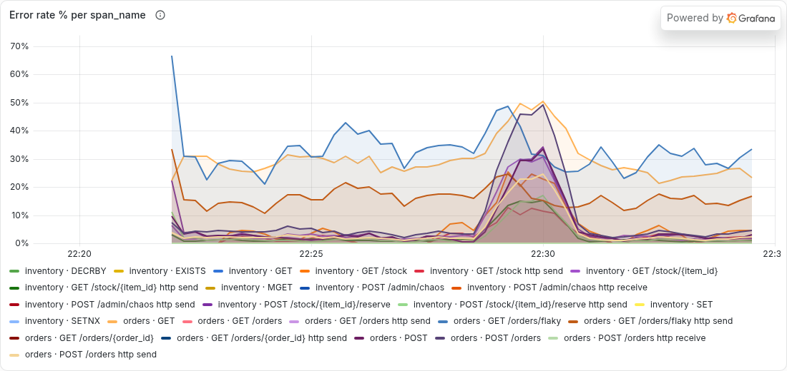

**In the screenshot:**
- **Steady lines at about 25–35%:** `orders · GET /orders/flaky` (blue, about 30%, by design)
  and `orders · GET` (light orange, about 25–30%: the outgoing call to inventory, high because
  of the 404s).
- **About 15%:** `orders · GET /orders/flaky http send` (dark orange). The internal send step of
  a 500 response is also marked ERROR.
- **Error phase (about 22:29–22:30):** a bundle of lines jumps to about 15–50%. These are
  `orders · POST` and `orders · POST /orders` (the purple ones, about 45–50%), plus
  `inventory · GET /stock/{item_id}`, `inventory · POST /stock/{item_id}/reserve` and `GET /stock`
  (about 15–35%).
- The spike to about 65% at the very start is the same startup artifact as in panel [5].

### [9] p95 latency per span_name

**Query:**
```promql
histogram_quantile(0.95,
  sum by (le, service, span_name) (rate(traces_spanmetrics_latency_bucket{service=~"$service"}[$__rate_interval])))
```

**How to read it:** compare a parent with its children to see where time goes:
- `orders · POST /orders` ≈ `orders · GET` + `orders · POST` + a bit of own work.
- `orders · GET` (client) ≈ `inventory · GET /stock/{item_id}` (server) + network time.
- redis commands are normally a few ms. If inventory is slow but redis stays fast, the time
  is spent in inventory's own code. That is exactly what the latency-injection test shows.
- Exemplars are on here too.

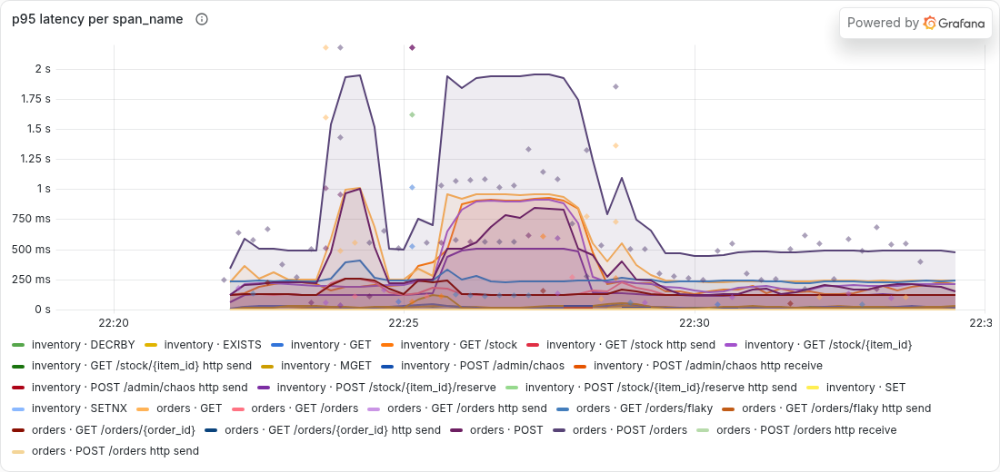

**In the screenshot:**
- **Top line (dark purple), `orders · POST /orders`:** about 500 ms normally, about **1.9 s**
  during the latency phase.
- **Middle group (orange and pink, about 850–950 ms during the phase):** the outgoing
  `orders · GET` / `orders · POST` calls and the inventory routes
  `GET /stock/{item_id}` and `POST /stock/{item_id}/reserve`.
- **redis commands** (`inventory · GET`, `EXISTS`, `DECRBY`, ...) stay along the bottom at a few
  ms the whole time.

This is the key reading: **the extra time is inside inventory, not in redis.**

---

## 7. Row 4: Recent traces (TraceQL tables)

These two panels query **Tempo directly** (not Prometheus). They return a list of real
traces from the selected time range, newest first, up to 20.

**Columns:**

| Column | Meaning |
|--------|---------|
| Trace ID | click it to open the full trace (waterfall view) |
| Start time | when the trace started |
| Service | the root service (where the trace began; normally `orders`, or `inventory` for direct calls) |
| Name | the root span name, e.g. `POST /orders` |
| Duration | end-to-end duration of the whole trace |

Expand a row (▸) to see the **matching spans**, i.e. the spans that satisfied the query.

### [10] Slow traces (> 300 ms)

**Query (TraceQL):**
```
{ resource.service.name =~ "${service:regex}" && traceDuration > 300ms }
```
- `resource.service.name =~ ...`: the trace must contain a span from a selected service
  (`${service:regex}` becomes e.g. `(inventory|orders)`).
- `traceDuration > 300ms`: the **whole trace** (first span start to last span end) took
  more than 300 ms.

**How to read it:** normally mostly `POST /orders` traces (two inventory calls). During the
latency test almost every trace that touches inventory appears. Open one and look for the
widest bar to find the slow step.

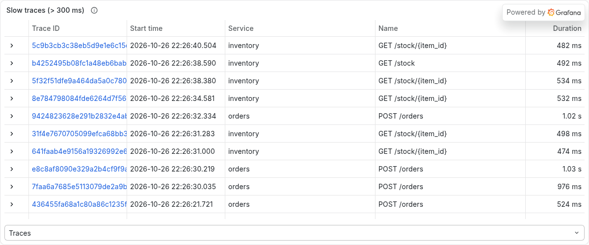

**In the screenshot:** traces from the latency phase (22:26:21–22:26:40). inventory routes
(`GET /stock/{item_id}`, `GET /stock`) take about **470–530 ms**: normally about 100 ms, plus the
injected 400 ms. orders `POST /orders` traces take about **1 s** (two slow inventory calls).
The *Traces* dropdown at the bottom switches the table between traces and matching spans.

Clicking a trace ID opens the waterfall. Here is one of these slow traces (`079164e4…`,
1.11 s):

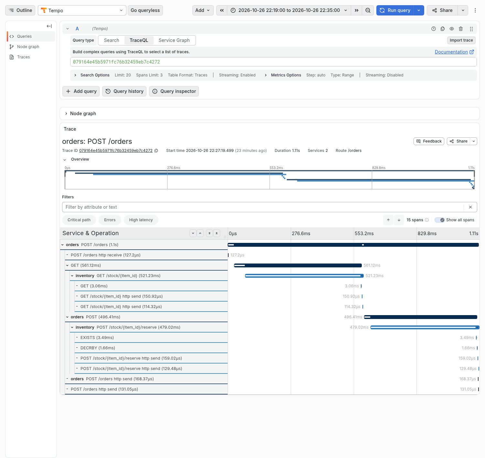

How to read the waterfall: each row is a span, indented under its parent, and the bar shows
when it started and how long it took.
- `orders POST /orders` takes the full 1.11 s.
- Under it, the `GET` call to inventory takes **561 ms**, and inside it inventory's
  `GET /stock/{item_id}` takes **521 ms**, but its redis `GET` takes only **3 ms**.
- The same pattern repeats for `POST` (496 ms) → `POST /stock/{item_id}/reserve` (479 ms) →
  `EXISTS` 3.5 ms and `DECRBY` 1.7 ms.

So the time is lost inside inventory's own code, which is where the latency was injected.
The *Critical path* and *High latency* buttons above the table highlight this automatically.

### [11] Error traces

**Query (TraceQL):**
```
{ resource.service.name =~ "${service:regex}" && status = error }
```
A trace matches when a span **of a selected service** has status ERROR (the condition is
evaluated per span).

**How to read it:** you see `GET /orders/flaky` traces, `POST /orders` traces with a 502,
and orders traces whose `GET` client call got a 404. Open a trace and click the red span →
**Events → exception** to read the reason, e.g.
- `RuntimeError: injected failure (chaos error_rate=0.5)` (inventory, error injection)
- `httpx.ConnectError: All connection attempts failed` (orders, inventory stopped)
- `RuntimeError: random failure (flaky endpoint)` (orders `/orders/flaky`)

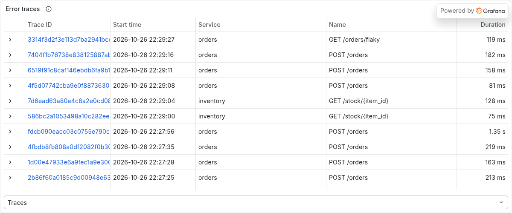

**In the screenshot:**
- Traces from the error phase (22:29:00–22:29:27): orders `POST /orders` traces that failed
  because inventory failed, two direct inventory `GET /stock/{item_id}` calls that hit the
  injected error, and a `GET /orders/flaky`.
- Further down (22:27:25–22:27:56) are `POST /orders` traces from before the error phase.
  These are typically orders whose inventory call returned 404 (unknown item) or hit the
  default 2% error rate. One of them (1.35 s) is from the end of the latency phase.

One of the error-phase traces opened (`17e4f511…`, 198 ms):

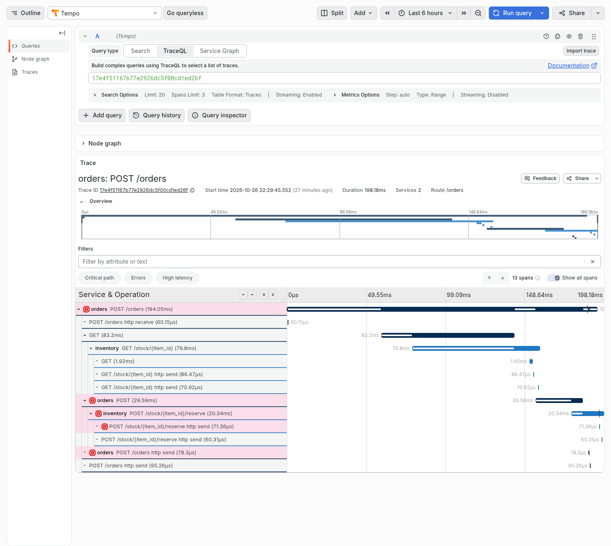

How to read it: spans with status ERROR are marked with a red icon and a pink background.
The chain of red runs from `orders POST /orders` → `orders POST` (the call to inventory) →
`inventory POST /stock/{item_id}/reserve`, so the failure started in inventory and travelled
up to orders. Note that the failed `reserve` span has **no redis children** (no `EXISTS` /
`DECRBY`): the injected failure fires before inventory touches redis. The first call
(`GET /stock/{item_id}` with its redis `GET`) succeeded. Clicking the red inventory span and
opening **Events** shows `exception: RuntimeError: injected failure (chaos error_rate=0.3)`.
The red `http send` step is the internal ASGI step that sent the 500 response. The *Errors*
button above the table jumps between the red spans.

---

## 8. Quick reference: which panel answers which question

| Question | Panel |
|----------|-------|
| Which services talk to each other? | [1] Service graph |
| Is traffic between two services normal? | [2] Calls between services |
| Which connection is failing? | [3] Failed calls, [1] red edges |
| How busy / how broken / how slow is each service? | [4] / [5] / [6] |
| Which route or redis command causes it? | [7] / [8] / [9] |
| Show me an example of a slow request | [10], or an exemplar diamond in [6] or [9] |
| Show me an example of a failing request and why | [11] → red span → Events |

## 9. Things to keep in mind

- **Delay.** Span metrics appear about 15–30 s after a request (batching in the collector,
  then Tempo, then remote write), and a trace becomes searchable a few seconds after its last
  span. Rate panels average over about a minute.
- **100% sampling.** Every request is traced, so counts here equal real traffic. With
  sampling in production, span-metric counts would only cover the sampled requests.
- **`/health` is excluded** from tracing, so health checks never show up here.
- **Restarting Tempo** resets the generator's in-memory counters. `rate()` handles counter
  resets, but you may see a short gap.
- **No data?** Run `.\scripts\load-test.ps1 -Duration 2m`, wait 30 s, and check the time
  range. `.\scripts\verify.ps1 -Dashboards traces` tests every panel of this dashboard.
