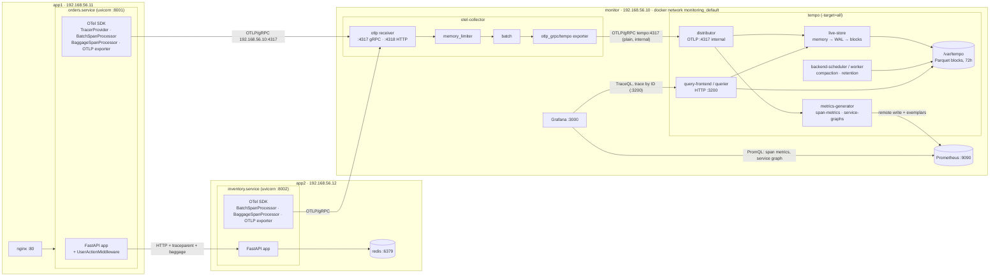
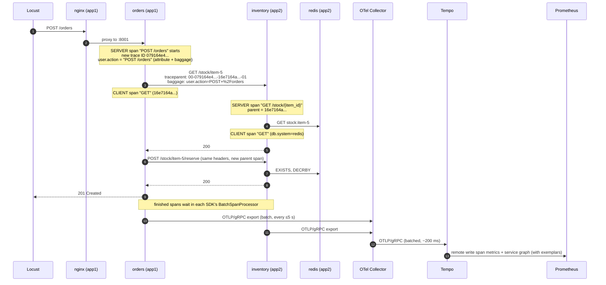

# How traces are collected: tech stack and architecture

This document explains, end to end, how a distributed trace is produced, transported,
stored and shown in this lab. It covers the tech stack (with versions), the architecture,
the life of one request step by step (with real IDs and headers from the lab), which config
file controls which part, timing, storage, and what happens when a component fails.

Related: [traces-dashboard.md](traces-dashboard.md) explains the Grafana *Traces* dashboard
panel by panel, and the [README](../README.md) covers start/stop, URLs and testing.

---

## 1. Summary

```
 app1 / app2 (Python services)          monitor VM (docker compose)
┌────────────────────────────┐        ┌─────────────────────────────────────────────────────┐
│ FastAPI app                │        │                                                     │
│  + OpenTelemetry SDK       │  OTLP  │  OTel Collector ──OTLP──▶ Tempo ──remote write──▶ Prometheus
│    (auto-instrumentation)  │──gRPC─▶│   :4317            (internal)  │  (span metrics,     │
│  creates spans, propagates │  :4317 │                               │   service graph)    │
│  context to the next call  │        │                               ▼                     │
└────────────────────────────┘        │                 Grafana ◀── TraceQL / trace by ID   │
                                      └─────────────────────────────────────────────────────┘
```

1. **Produce:** the OpenTelemetry SDK inside each service records a **span** for every
   incoming request, outgoing HTTP call and redis command. It passes the trace context to
   the next service in HTTP headers (`traceparent`, `baggage`), so all spans of one request
   share one **trace ID**.
2. **Transport:** the SDK batches finished spans and sends them over **OTLP/gRPC** to the
   **OpenTelemetry Collector**. The collector batches again and forwards them to **Tempo**.
3. **Store:** **Grafana Tempo** groups the spans into traces, keeps recent ones in memory and
   writes them to disk as Parquet blocks (kept 72 h). Its **metrics-generator** also turns
   every span into metrics (rates, errors, latency histograms, service graph) and writes
   them into **Prometheus**.
4. **Show:** **Grafana** searches and displays traces from Tempo (TraceQL) and charts the
   span metrics from Prometheus. **Exemplars** link a point on a latency chart to the
   exact trace.

---

## 2. Tech stack

### On the application VMs (app1, app2)

| Component | Version | Role |
|-----------|---------|------|
| Python | 3.10.12 (Ubuntu 22.04) | runtime for the services, each in its own venv `/opt/<service>/venv` |
| FastAPI / uvicorn | 0.143.0 / 0.54.0 | the `orders` (app1:8001) and `inventory` (app2:8002) web services |
| httpx | 0.28.1 | HTTP client that orders uses to call inventory |
| redis (Python client) / redis-server | 8.1.0 / Ubuntu package | inventory's data store |
| nginx | Ubuntu package | reverse proxy :80 → orders (not traced) |
| **opentelemetry-api / -sdk** | **1.45.1** | the tracing API and its implementation: spans, context, sampling, processors |
| **opentelemetry-distro** | **0.66b1** | default SDK setup, used by `opentelemetry-instrument` |
| **opentelemetry-instrument** (from `opentelemetry-instrumentation`) | 0.66b1 | launcher that sets up the SDK and instruments libraries *before* the app starts, with zero code changes |
| **opentelemetry-instrumentation-fastapi / -asgi** | 0.66b1 | SERVER spans for incoming requests, plus HTTP metrics |
| **opentelemetry-instrumentation-httpx** | 0.66b1 | CLIENT spans for outgoing HTTP calls; injects the propagation headers |
| **opentelemetry-instrumentation-redis** | 0.66b1 | CLIENT spans for redis commands (`db.system=redis`) |
| **opentelemetry-processor-baggage** | 0.66b1 | `BaggageSpanProcessor`: copies the `user.action` baggage entry onto every span |
| **opentelemetry-exporter-otlp (proto-grpc)** | 1.45.1 | sends spans and metrics to the collector over OTLP/gRPC |

### On the monitor VM (Docker Compose in `/opt/monitoring`)

| Component | Image | Role in tracing |
|-----------|-------|-----------------|
| **OpenTelemetry Collector (contrib)** | `otel/opentelemetry-collector-contrib:0.162.0` | receives OTLP from the services, batches it, and forwards traces to Tempo (and metrics to Prometheus) |
| **Grafana Tempo** | `grafana/tempo:3.1.0` | trace database: ingest, storage, TraceQL search, metrics-generator |
| **Prometheus** | `prom/prometheus:v3.15.0` | stores the metrics Tempo generates (via remote write) and the SDK metrics (with exemplars) |
| **Grafana** | `grafana/grafana:13.2.3` | UI: Tempo + Prometheus datasources, dashboards *Traces* and *Actions*, Explore |

### Standards and protocols used

| Standard | Used for |
|----------|----------|
| **OpenTelemetry** (OTel) | vendor-neutral API, SDK, data model and semantic conventions for traces and metrics |
| **OTLP** (OpenTelemetry Protocol) over **gRPC** (port 4317) | services → collector and collector → Tempo |
| **W3C Trace Context** (`traceparent` header) | passing trace ID and parent span ID between services |
| **W3C Baggage** (`baggage` header) | passing `user.action` to downstream services |
| **TraceQL** | Tempo's query language for searching traces |
| **Prometheus remote write** (with exemplars) | Tempo metrics-generator → Prometheus |
| **OpenMetrics** exposition | collector → Prometheus scrape, so that SDK exemplars are included |
| **Apache Parquet** | Tempo's on-disk block format |

---

## 3. Architecture

### 3.1 Components and data paths



If your Markdown viewer can't render Mermaid, the summary diagram in section 1 shows the
same flow.

### 3.2 Inside Tempo 3.1 (monolithic mode)

Tempo runs as a single process (`-target=all`, *monolithic mode*). In Tempo 3.x this mode
needs **no Kafka**: the distributor hands data in-process to the live-store and the
metrics-generator. In microservices mode, Kafka and a separate block-builder would sit in
between.

| Tempo component | What it does here |
|-----------------|-------------------|
| **distributor** | receives OTLP spans from the collector on `:4317` (docker network only) and passes them to the live-store and the metrics-generator |
| **live-store** | assembles spans into traces in memory, organised by trace ID. When a trace has received no new spans for `max_trace_idle` (default **10 s**), it is written to the local WAL in Parquet format, where TraceQL can search it. Later the WAL is cut into complete blocks. |
| **storage (local backend)** | blocks in `/var/tempo/blocks`, WAL in `/var/tempo/wal`, on the docker volume `tempo-data` |
| **backend-scheduler / backend-worker** | background jobs: compacting small blocks into bigger ones, and deleting blocks older than `block_retention` (**72 h**). This replaces the old `compactor` of Tempo 2.x. |
| **metrics-generator** | computes metrics from every span: **span-metrics** (calls, errors, latency histogram per service / span name / kind / status / `user_action`) and **service-graphs** (calls and latency between services). It writes them to Prometheus via remote write, with exemplars. |
| **query-frontend / querier** | serve the HTTP API on `:3200`: `/api/search` (TraceQL), `/api/v2/traces/<id>`, tag lookups. They read recent data from the live-store and older data from blocks. |

---

## 4. The life of one request, step by step

The example is a real trace from the lab: `POST /orders`, trace ID
`079164e45b5971fc76b32459eb7c4272`, captured during the latency test.



### Step 1: the SDK is set up before the app starts

The systemd unit starts the service through the OTel launcher
([services/orders/orders.service](../services/orders/orders.service)):

```ini
Environment=OTEL_SERVICE_NAME=orders
Environment=OTEL_RESOURCE_ATTRIBUTES=host.name=app1,deployment.environment=lab
Environment=OTEL_EXPORTER_OTLP_ENDPOINT=http://192.168.56.10:4317
Environment=OTEL_EXPORTER_OTLP_PROTOCOL=grpc
Environment=OTEL_TRACES_EXPORTER=otlp
Environment=OTEL_PROPAGATORS=tracecontext,baggage
Environment=OTEL_PYTHON_FASTAPI_EXCLUDED_URLS=/health
ExecStart=/opt/orders/venv/bin/opentelemetry-instrument /opt/orders/venv/bin/uvicorn main:app ...
```

`opentelemetry-instrument` runs before the application code is imported, and it:

1. Creates a **Resource**, the identity attached to every span of this process:
   `service.name=orders`, `host.name=app1`, `deployment.environment=lab`, a random
   `service.instance.id`, plus `telemetry.sdk.*` (language python, version 1.45.1).
2. Creates the **TracerProvider** with the default sampler (`parentbased_always_on`, i.e.
   **100% sampling**: every trace is kept).
3. Adds a **BatchSpanProcessor** with an **OTLP gRPC span exporter** aimed at
   `192.168.56.10:4317`.
4. Sets the **propagators** `tracecontext` (W3C `traceparent`) and `baggage` (W3C `baggage`).
5. Loads every installed **instrumentation** and patches the libraries: FastAPI/Starlette
   (wraps the app in an ASGI middleware), httpx (wraps the transport) and redis (wraps
   command execution).

Then `main.py` is imported and adds one more processor (the only tracing code in the apps
besides the middleware):

```python
trace.get_tracer_provider().add_span_processor(BaggageSpanProcessor(lambda key: key == "user.action"))
```

### Step 2: the request arrives at orders, and a trace begins

Locust → nginx → orders. The OTel **ASGI middleware** (outermost layer of the app):

1. tries to **extract** a trace context from the request headers. Locust sends none, so a
   **new trace ID** is generated: `079164e45b5971fc76b32459eb7c4272`;
2. starts the **SERVER span** `POST /orders` (span ID `2dc1a1a28e7dba97`, no parent = the
   *root span*) and makes it the *current span*;
3. records attributes following the OTel HTTP semantic conventions: `http.method=POST`,
   `http.url`, `http.target=/orders`, `http.route=/orders`, and later `http.status_code=201`.

Next, orders' own **`UserActionMiddleware`** finds the matched route **template** and:
- sets `user.action = "POST /orders"` as an attribute on the server span, and
- puts `user.action` into the OTel **baggage** of the current context.

### Step 3: orders calls inventory, and the context travels in headers

When orders runs `client.get("/stock/item-5")`, the **httpx instrumentation**:

1. starts a **CLIENT span** `GET` (span ID `16e7164aed28b584`, parent = `2dc1a1a28e7dba97`).
   `BaggageSpanProcessor` sees `user.action` in the context and copies it onto this span;
2. **injects** the context into the outgoing request headers via the configured propagators.
   These are the actual headers on the wire:

   ```
   traceparent: 00-079164e45b5971fc76b32459eb7c4272-16e7164aed28b584-01
   baggage: user.action=POST+%2Forders
   ```

   | `traceparent` part | Value | Meaning |
   |--------------------|-------|---------|
   | version | `00` | W3C Trace Context version |
   | trace-id | `079164e45b5971fc76b32459eb7c4272` | 16 bytes, the same for every span of this request |
   | parent-id | `16e7164aed28b584` | 8 bytes, the span ID of the **caller's CLIENT span** |
   | flags | `01` | *sampled*: the caller recorded this trace, so the callee records it too |

   `baggage` carries arbitrary key/value pairs, URL-encoded (`POST /orders` →
   `POST+%2Forders`).

### Step 4: inventory continues the same trace

In inventory the ASGI middleware **extracts** both headers:
- It starts the **SERVER span** `GET /stock/{item_id}` (span ID `3d161038451f5625`) with
  **parent = `16e7164aed28b584`** and the **same trace ID**. This link is what makes the
  two services one connected trace.
- The baggage is now in inventory's context, so `BaggageSpanProcessor` copies
  `user.action = "POST /orders"` onto this span and onto every span started under it.

Inside the handler, the **redis instrumentation** creates a **CLIENT span** `GET`
(span ID `6a8729fbb8aa707d`, parent = `3d161038451f5625`) with `db.system=redis`,
`db.statement=GET ?` (arguments are masked) and `net.peer.name=127.0.0.1`.

The second call (`POST /stock/item-5/reserve`) works the same way, with a new CLIENT span
in orders as the parent and `EXISTS` / `DECRBY` redis spans underneath. The finished trace
has **15 spans** across 2 services: see the waterfall screenshot in
[traces-dashboard.md](traces-dashboard.md#7-row-4-recent-traces-traceql-tables).

### Step 5: the spans leave the services

A span is exported only after it **ends**. Each finished span is placed in the SDK's
**BatchSpanProcessor** queue, which sends a batch to the collector (OTel spec defaults,
configurable with `OTEL_BSP_*` env vars):

| Setting | Default | Meaning |
|---------|---------|---------|
| `OTEL_BSP_SCHEDULE_DELAY` | 5000 ms | export at least every 5 s |
| `OTEL_BSP_MAX_EXPORT_BATCH_SIZE` | 512 | or as soon as 512 spans are waiting |
| `OTEL_BSP_MAX_QUEUE_SIZE` | 2048 | spans beyond this are **dropped** (e.g. if the collector is unreachable for long) |
| `OTEL_BSP_EXPORT_TIMEOUT` | 30000 ms | per export attempt |

Export is asynchronous, in a background thread, so the request itself is never slowed
down by tracing I/O. The payload is OTLP protobuf over gRPC to `192.168.56.10:4317`
(published port of the collector container). Metrics use the same connection on their own
15 s cycle (`OTEL_METRIC_EXPORT_INTERVAL=15000`).

### Step 6: the collector forwards to Tempo

Pipeline in [monitoring/otel-collector/config.yaml](../monitoring/otel-collector/config.yaml):

```yaml
traces:
  receivers:  [otlp]                 # :4317 gRPC / :4318 HTTP
  processors: [memory_limiter, batch]
  exporters:  [otlp_grpc/tempo]      # tempo:4317, plain gRPC on the docker network
```

| Stage | What it does |
|-------|--------------|
| `otlp` receiver | accepts spans from all services |
| `memory_limiter` | refuses data when the collector uses more than 400 MiB, to protect itself |
| `batch` | groups spans into larger batches (default: send after 8192 spans or 200 ms) |
| `otlp_grpc/tempo` exporter | sends to Tempo, with built-in **retry** and an in-memory **sending queue** for short Tempo outages |

No sampling happens here (100% kept). The file contains a commented **tail_sampling**
example for production (keep errors and slow traces, plus 10% of the rest).

Why have a collector at all instead of sending directly to Tempo? It decouples the apps
from the backend. Sampling, filtering, PII redaction, extra attributes or a second backend
can be added in one place without touching the services. The services only know one
endpoint.

### Step 7: Tempo stores the trace and generates metrics

1. The **distributor** receives the batch and pushes it to the **live-store** and the
   **metrics-generator**.
2. The **live-store** merges spans by trace ID. About **10 s** after the last span of a trace
   arrives (`max_trace_idle`), the trace is written to the WAL (Parquet) and becomes
   **searchable with TraceQL**. A lookup by trace ID works even earlier, from memory.
3. Later the WAL is cut into **blocks** on disk. Background jobs compact them and delete
   blocks older than **72 h** ([monitoring/tempo/tempo.yaml](../monitoring/tempo/tempo.yaml)).
4. The **metrics-generator** updates its counters and histograms for every span:
   - **span-metrics** → `traces_spanmetrics_calls_total`, `traces_spanmetrics_latency_*`,
     labelled by `service`, `span_name`, `span_kind`, `status_code` and `user_action`
     (configured with `dimensions: [user.action]`);
   - **service-graphs** → `traces_service_graph_request_total`, `_failed_total` and
     latency histograms, labelled `client` / `server`. It pairs a CLIENT span with the
     SERVER span it called, e.g. orders → inventory. Calls to redis have no server span,
     so they become a *virtual node* named after the span's `db.system` attribute.
   - The series are written to Prometheus with **remote write**
     (`http://prometheus:9090/api/v1/write`, `send_exemplars: true`). Each latency
     histogram sample can carry a trace ID as an **exemplar**.

### Step 8: Prometheus stores the metrics

Prometheus receives the generated series by remote write (enabled with
`--web.enable-remote-write-receiver`) and keeps exemplars
(`--enable-feature=exemplar-storage`). It also **scrapes**:
- the collector's `:8889` endpoint for the SDK's own HTTP metrics
  (`http_server_duration_milliseconds_*`). These come with exemplars too, because the
  SDK attaches the current trace ID to measurements and the exporter uses the OpenMetrics
  format;
- Tempo's `:3200/metrics` (Tempo's own health metrics, e.g.
  `tempo_distributor_spans_received_total`).

### Step 9: Grafana reads it all

Datasources ([monitoring/grafana/provisioning/datasources/prometheus.yml](../monitoring/grafana/provisioning/datasources/prometheus.yml)):

| Datasource | Used for |
|------------|----------|
| **Tempo** (`http://tempo:3200`) | TraceQL search tables, trace view (waterfall), Explore. **serviceMap → Prometheus**: the node graph is built from `traces_service_graph_*`. **tracesToMetrics → Prometheus**: "related metrics" links on each span. **nodeGraph** enabled. |
| **Prometheus** (`http://prometheus:9090`) | all time-series panels. **exemplarTraceIdDestinations → Tempo** for both label names `trace_id` (SDK exemplars) and `traceID` (Tempo exemplars), so clicking an exemplar opens its trace. |

---

## 5. When does data appear?

| Event | Typical delay after the request | Why |
|-------|---------------------------------|-----|
| spans leave the service | 0–5 s | BatchSpanProcessor schedule (5 s) |
| collector → Tempo | +0.2 s | batch processor timeout |
| trace viewable by ID | ~1–6 s | Tempo live-store memory |
| trace **searchable** (TraceQL tables, Explore search) | ~10–20 s | live-store `max_trace_idle` 10 s, then WAL flush |
| span metrics in Prometheus | ~15–30 s | metrics-generator collection + remote-write interval |
| visible in rate/p95 charts | ~1 min | `rate()` over `$__rate_interval` (about 1 min) |

---

## 6. What a span contains (real example)

The inventory SERVER span from the trace above, as stored in Tempo (OTLP data model):

| Field | Value |
|-------|-------|
| trace ID | `079164e45b5971fc76b32459eb7c4272` |
| span ID | `3d161038451f5625` |
| parent span ID | `16e7164aed28b584` (orders' httpx CLIENT span) |
| name | `GET /stock/{item_id}` |
| kind | `SPAN_KIND_SERVER` |
| start / end | nanosecond timestamps → duration 521 ms (latency test) |
| status | `UNSET` (would be `ERROR` for a 5xx) |
| instrumentation scope | `opentelemetry.instrumentation.fastapi` 0.66b1 |
| span attributes | `http.method=GET`, `http.url=http://192.168.56.12:8002/stock/item-5`, `http.target=/stock/item-5`, `http.route=/stock/{item_id}`, `http.status_code=200`, `user.action=POST /orders` |
| resource attributes | `service.name=inventory`, `host.name=app2`, `deployment.environment=lab`, `service.instance.id=…`, `telemetry.sdk.language=python`, `telemetry.sdk.version=1.45.1` |
| events | for errors: an `exception` event with `exception.type`, `exception.message`, `exception.stacktrace` |

**Resource** attributes describe *who* produced the span (the same for all spans of a
process). **Span** attributes describe *this operation*.

---

## 7. Which file controls what

| Concern | File | Key settings |
|---------|------|--------------|
| Service identity, exporter, propagation, exclusions | `services/<svc>/<svc>.service` | `OTEL_SERVICE_NAME`, `OTEL_RESOURCE_ATTRIBUTES`, `OTEL_EXPORTER_OTLP_ENDPOINT`, `OTEL_TRACES_EXPORTER=otlp`, `OTEL_PROPAGATORS`, `OTEL_PYTHON_FASTAPI_EXCLUDED_URLS` |
| Instrumentation packages | `services/<svc>/requirements.txt` + `opentelemetry-bootstrap -a install` in [provision/python-service.sh](../provision/python-service.sh) | fastapi / httpx / redis instrumentations, baggage processor |
| `user.action` and baggage copying | [services/orders/main.py](../services/orders/main.py), [services/inventory/main.py](../services/inventory/main.py) | `UserActionMiddleware`, `BaggageSpanProcessor`, `record_exception` on deliberate errors |
| Collector pipelines | [monitoring/otel-collector/config.yaml](../monitoring/otel-collector/config.yaml) | traces pipeline, `otlp_grpc/tempo`, commented `tail_sampling` |
| Tempo storage, retention, metrics-generator | [monitoring/tempo/tempo.yaml](../monitoring/tempo/tempo.yaml) | local storage, `block_retention: 72h`, `processors: [service-graphs, span-metrics]`, `dimensions: [user.action]`, `peer_attributes`, remote write |
| Tempo container | [monitoring/docker-compose.yml](../monitoring/docker-compose.yml) | `grafana/tempo:3.1.0`, `-target=all`, volume `tempo-data`, only `:3200` published |
| Prometheus receiving generated metrics | [monitoring/docker-compose.yml](../monitoring/docker-compose.yml), [monitoring/prometheus/prometheus.yml](../monitoring/prometheus/prometheus.yml) | `--web.enable-remote-write-receiver`, `--enable-feature=exemplar-storage`, `tempo` scrape job |
| Grafana links between traces and metrics | [monitoring/grafana/provisioning/datasources/prometheus.yml](../monitoring/grafana/provisioning/datasources/prometheus.yml) | Tempo datasource (`serviceMap`, `nodeGraph`, `tracesToMetrics`), `exemplarTraceIdDestinations` |
| Dashboards | [scripts/generate-dashboards.py](../scripts/generate-dashboards.py) → `monitoring/grafana/dashboards/*.json` | *Traces*, *Actions*, latency panels with exemplars |

---

## 8. Network and ports

| From → to | Address | Protocol | Exposed outside the monitor VM? |
|-----------|---------|----------|------------------------------|
| orders, inventory → collector | `192.168.56.10:4317` | OTLP/gRPC | yes (host-only network) |
| (unused) → collector | `192.168.56.10:4318` | OTLP/HTTP | yes |
| collector → Tempo | `tempo:4317` | OTLP/gRPC, plain text | **no**, docker network only |
| Tempo → Prometheus | `prometheus:9090/api/v1/write` | Prometheus remote write | internal |
| Prometheus → collector | `otel-collector:8889` | HTTP scrape (OpenMetrics) | `:8889` published for debugging |
| Prometheus → Tempo | `tempo:3200/metrics` | HTTP scrape | |
| Grafana → Tempo | `tempo:3200` | Tempo HTTP API | `:3200` published (API, `/ready`) |
| Grafana → Prometheus | `prometheus:9090` | PromQL HTTP API | `:9090` published |
| you → Grafana | `192.168.56.10:3000` | HTTP | yes |

---

## 9. Storage and retention

| Data | Where | Kept for |
|------|-------|----------|
| trace blocks (Parquet) + WAL | docker volume `tempo-data` → `/var/tempo` in the Tempo container | **72 h** (`block_retention`) |
| metrics-generator WAL (remote-write buffer) | `/var/tempo/generator/wal` | until written to Prometheus |
| span metrics, service graph, SDK metrics, exemplars | docker volume `prometheus-data` | metrics **30 days**; exemplars live in a fixed-size in-memory buffer, so only recent ones are kept |
| in-flight spans | SDK queue (max 2048 per process), collector memory | seconds |

`vagrant halt` keeps all volumes. `vagrant destroy` deletes everything.

---

## 10. What happens when something fails

| Failure | Effect on traces | Recovery |
|---------|------------------|----------|
| **inventory stopped** | orders' CLIENT span gets status ERROR with `httpx.ConnectError`. The trace has **only orders spans**, because nobody answered. | automatic once inventory is back |
| **collector down** | each SDK retries the export and queues up to 2048 spans, then **drops** new spans. The apps keep working normally. | spans produced during a long outage are lost |
| **Tempo down / restarting** | the collector exporter retries and buffers in its in-memory sending queue. A long outage overflows it, and spans are dropped. | collector logs `connection refused tempo:4317` until Tempo is back |
| **Prometheus down** | traces are still stored. The metrics-generator buffers in its WAL and resends. | span-metric charts show a gap or catch up |
| **Grafana down** | nothing is lost; only the UI is unavailable | |
| **trace spans out of order / late** | the live-store merges by trace ID. Spans arriving more than `max_trace_idle` late may end up in a separate block, but queries still combine them. | |

The design rule: **tracing must never break the application.** All export is
asynchronous, in-memory and best-effort.

---

## 11. What is *not* traced

| Thing | Why | How it is still observed |
|-------|-----|--------------------------|
| nginx | no OTel module installed | process/systemd metrics; the orders SERVER span starts right after nginx |
| redis server internals | redis emits no spans | redis **client** spans in inventory, plus the virtual `redis` node in the service graph |
| `/health` | excluded via `OTEL_PYTHON_FASTAPI_EXCLUDED_URLS=/health` to avoid noise | provisioning health checks |
| Locust | the load generator sends no `traceparent` | appears as the `user` node in the service graph |

---

## 12. From lab to production

| Lab choice | Production alternative |
|------------|------------------------|
| 100% sampling | tail sampling in the collector (commented example), or head sampling with `OTEL_TRACES_SAMPLER=parentbased_traceidratio` |
| one collector | a gateway pool of collectors, with a `loadbalancing` exporter by trace ID when tail sampling |
| Tempo monolithic, local disk | Tempo microservices mode with Kafka and object storage (S3/GCS/Azure) |
| plain gRPC / HTTP, admin/admin | TLS on OTLP and Tempo, authentication, network policies |
| all attributes kept | redact or drop PII centrally with collector processors (`attributes`, `redaction`, `transform`); never put personal data in baggage, because baggage is sent to every downstream service |
| `user.action` as a span-metrics dimension | fine as long as its values stay low-cardinality (route templates only) |
